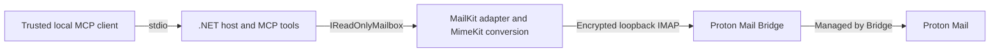

# Approved MVP design

Status: approved by the project owner on 2026-10-17; Phases 1–3 implemented with synthetic evidence. The mailbox adapter and MCP contracts are implemented; live Bridge acceptance remains Phase 4. This document records the approved architecture and behavior. [PLAN.md](PLAN.md) tracks execution; [SECURITY.md](SECURITY.md) defines the security boundaries.

## Goals and scope

Allow a trusted local MCP client to discover permitted folders, search message summaries, and retrieve a message's text without changing mailbox content or persistent flags.

The MVP serves one user and one Bridge account on Linux. The client starts the application as a stdio child process. Bridge remains a separately installed and operated dependency. The server must not manage Bridge login, Proton encryption keys, or Bridge's internal cache.

Expose only explicitly configured folders, initially `INBOX`. Support headers, sender-date filters, unread filters, text bodies, and attachment metadata. Exclude HTTP, SMTP, body search, attachment payloads, multiple accounts, persistent caching/indexing, background synchronization, and direct Proton APIs.

## Architecture



Create one console application project targeting `net10.0` and one xUnit test project. The intended layout is:

```text
src/ProtonMailMcp/
  Configuration/   # Validated options, secret/certificate loading
  Contracts/       # Application inputs, result DTOs, error categories
  Mail/            # IReadOnlyMailbox, MailKit adapter, MIME conversion
  Tools/           # Three MCP handlers and descriptions
tests/ProtonMailMcp.Tests/
  Unit/
  Protocol/
  Mcp/
  LiveBridge/
  Fixtures/        # Synthetic data only
```

The host owns dependency injection, configuration validation, lifetime, and stderr logging. Use the official SDK's `ModelContextProtocol` hosting package with Generic Host and stdio transport. Do not introduce ASP.NET Core.

`IReadOnlyMailbox` exposes only the three read capabilities below, with asynchronous methods and cancellation tokens. It returns application DTOs, never MailKit clients, folders, or mutable message objects. The concrete adapter owns MailKit usage. MIME text conversion should be independently testable without a network connection.

Explicitly register approved tools rather than broadly discovering every attributed method in the assembly. Mark them read-only and non-destructive; these annotations do not enforce safety.

## Tool contracts

### `list_folders`

No arguments. Return existing, selectable folders from the allowlist, using Bridge's full folder names. Do not return unapproved folder names or create, subscribe to, or repair missing folders. Nonselectable and missing entries are not usable folders.

### `search_messages`

Required input: folder full name. Optional inputs: sender substring, recipient substring, subject substring, sent-date start, sent-date end, unread status, and limit.

- Combine supplied filters with AND. Use MailKit's typed search builders, never raw caller-supplied IMAP syntax.
- Recipient filtering covers To and Cc. Bcc is not a reliable search target for received mail.
- As requested by the project owner on 2026-10-18, dates use the sender's `Date` header through IMAP `SENTSINCE`/`SENTBEFORE`, at calendar-day precision: inclusive `sentStart`, exclusive `sentEnd`, ignoring time and timezone rather than converting to UTC. Reject malformed or reversed ranges. This replaces the original delivery-date filters; `receivedStart`/`receivedEnd` are no longer accepted. No fallback to IMAP internal date occurs. Missing, malformed or inaccurate sender dates can affect matching; Bridge's live handling remains to be verified.
- Unread omitted means either status; true means unseen; false means seen. Reading this flag must not change it.
- Default limit is 20; valid limits are 1 through 50. Reject invalid values rather than silently broadening a query.
- Return highest UIDs first within the selected folder. This ordering is not a guarantee of chronology by sender date.
- Return summaries and `truncated: true` when additional matches exist. There is no pagination or cross-folder search in the MVP; the caller narrows filters when results are truncated.
- An unfiltered search is permitted and returns the highest matching UIDs within the limit.

Each summary includes folder, UIDVALIDITY, UID, From, To/Cc, subject, sender date when available, IMAP internal date, seen status, and reported message size. Preserve absent/malformed optional metadata as absent rather than inventing values.

### `get_message`

Required inputs: folder full name, UIDVALIDITY, and UID. Validate unsigned identifiers and recheck the folder allowlist before network retrieval.

After opening the folder read-only, compare its current UIDVALIDITY. Reject a mismatch as a stale reference; do not reinterpret the UID in the new validity epoch. A missing UID returns not-found, including disappearance between summary and body fetch.

Return the summary, main text body, attachment metadata, and explicit content/truncation status:

- Fetch body structure first. Prefer the primary non-attachment `text/plain` body; otherwise convert the primary HTML body to text using MimeKit utilities without rendering or network access.
- Preserve the primary body selection rules for multipart alternatives/related content. Do not concatenate all alternatives or traverse attached messages as body text.
- Retrieve only the selected text part. Do not download the entire MIME message as a shortcut or fetch attachment payloads.
- Metadata includes attachment filename, MIME type, and reported size when available. Size describes the server-reported body-part size, not a promise of exact decoded bytes. Names are data, never filesystem paths.
- Reject selected text-part transfers over 1 MiB (1,048,576 bytes). Check advertised size and enforce actual transfer limits before unbounded buffering/conversion.
- Cap returned body text at 32,000 characters with a truncation indicator. Oversized, missing, malformed, or unsupported bodies yield metadata with an explanatory content status; do not silently report successful full-body retrieval.
- Do not fetch alternate bodies or attachments to bypass a size limit.

Use structured results supported by the selected official SDK version. Exact JSON property names and error-code spellings are frozen by Phase 3 contract tests and documented in [usage](docs/USAGE.md#tool-inputs-and-results).

## Phase 2 application boundary

`IReadOnlyMailbox` now exposes `ListFoldersAsync`, `SearchAsync`, and `GetMessageAsync` using immutable application records in `Contracts`. It is registered as a lazy singleton, so stdio initialization still makes no mailbox connection. Phase 3 explicitly registers only the three approved MCP tools. JSON uses camelCase properties, lowercase content-status strings, and snake_case error codes; see [usage](docs/USAGE.md#tool-inputs-and-results).

The MCP boundary uses three explicit `McpServerTool` instances, strict JSON deserialization, generated object schemas, and structured results with equivalent JSON text content. It catches runtime failures before SDK error formatting and emits only fixed codes; diagnostics contain only operation, correlation ID, duration, and outcome. Unknown fields, numeric strings, malformed dates, and missing required fields fail before adapter I/O. Received cancellation notifications pass through to the adapter; stdin EOF may drain an active operation to its deadline.

The adapter requests UID summaries and BODYSTRUCTURE before any body transfer. A top-level text body uses `BODY.PEEK[TEXT]`; nested bodies use their numeric section. The MailKit folder stream factory rejects literals over 1 MiB before allocation, and bounded backing streams also reject oversized writes. MIME transfer/charset decoding is strict; malformed text returns `Malformed`. MimeKit's tokenizer converts HTML to plain text without evaluating markup or retrieving references. Primary body candidates are checked to exclude attached text, attachment containers, and attached messages.

Returned subject/address fields are capped at 4,096 characters each, attachment filenames at 1,024, MIME types at 256, and attachment metadata at 100 entries with `AttachmentsTruncated`. Control characters are removed from metadata; body text preserves line breaks and tabs. Search substrings are nonblank, control-free, and capped at 1,024 characters. These bounds constrain output, not MailKit's internal metadata parsing or the total matching UID list.

Malformed protocol responses and unexpected disconnections map to a sanitized Bridge-unavailable error; explicit rejected commands and unconfirmed read-only access map to a sanitized protocol error. Error objects retain no underlying exception or server text. Successful sessions use LOGOUT; failed/cancelled sessions dispose immediately, with no folder close and no retry. A post-logout token check enforces the deadline even when MailKit absorbs cancellation during logout.

## Connection lifecycle and failure handling

Serialize mailbox operations using an asynchronous gate. One operation creates one client, connects, verifies TLS, authenticates, performs its read, and disconnects/disposes. Do not share an active MailKit client across concurrent calls.

The operation deadline is 30 seconds, including waiting for the gate. Pass the linked deadline and client cancellation through connection, authentication, search, fetch, and cleanup. Cleanup must not expunge or indefinitely extend the operation. Dispose a failed/cancelled connection; the next operation establishes a new one. Do not automatically retry authentication, TLS failures, or interrupted operations.

Open folders with `FolderAccess.ReadOnly`, verify the resulting access, and fetch body sections through PEEK. No read/write fallback is permitted. Disconnect without a folder-close command that could expunge. See the full controls in [SECURITY.md](SECURITY.md).

Configuration errors fail startup clearly and safely. Bridge availability is checked lazily by mailbox calls so a temporary Bridge outage does not prevent MCP initialization. Runtime errors distinguish invalid input, denied folder, unavailable/missing folder, Bridge unavailable, authentication failure, TLS failure, stale reference, message not found, and timeout. Unsupported/oversized body status is represented in a metadata result. Sanitize all exposed messages; never serialize raw exceptions or protocol transcripts. Execution errors use MCP tool-error semantics rather than masquerading as successful empty results; client cancellation follows the SDK's cancellation behavior.

## Configuration and observability

Load explicit configuration from outside the repository using a configuration-file path. Require owner-private regular files and private parent directories for the JSON settings, exported public certificate, and password; reject symlinks and writable ancestors before reading through validated handles. Required settings are Bridge username, IMAP port, explicit TLS mode, exported public certificate path, password-file path, and a nonempty folder allowlist. Host defaults to literal `127.0.0.1`; reject non-loopback addresses. Keep deadline and content/result limits fixed for the MVP.

The setup instructions will start the allowlist at `INBOX`; runtime must not silently replace a missing/empty allowlist. Folder names match configured full names, with the IMAP-defined case-insensitive handling of `INBOX`. No wildcards or automatic descendant access.

Use stderr for operation name, duration, outcome, and correlation ID. Stdout is MCP protocol only. Do not log credentials, folders, identifiers, addresses, subjects, search filters, bodies, or production wire traffic. No telemetry or persistent mailbox cache is part of the MVP.

## Decisions and trade-offs

| Decision | Reason | Cost or limitation |
| --- | --- | --- |
| Stdio and one local user | Small deployment and trust model | No remote/shared service |
| Allowlist, initially INBOX | Explicit data access | User must configure additional full folder names |
| One connection per operation | Simple ownership, cleanup, and recovery | Repeated TLS/authentication overhead |
| Serialized calls | Avoid shared IMAP state/concurrency hazards | No parallel mailbox throughput |
| No persistent cache | Minimize retained plaintext and invalidation logic | Repeated IMAP work |
| Top-N UID search, no pagination | Minimal search interface | Narrowing required; IMAP may still return many matching UIDs internally |
| Text and metadata only | Small, useful reading surface | No attachment content or full fidelity HTML |
| Exact certificate pin | Trust the specific local Bridge instance | Manual update when the certificate changes |
| Protocol plus live tests | Verify commands and Bridge behavior | Live compatibility must be checked separately |

The MVP does not promise constant-memory searches for arbitrarily large mailboxes, transactional snapshots, or stable results while other clients modify mail. UIDVALIDITY protects message identity; it is not a mailbox snapshot. Bridge labels/folders may expose the same underlying message in multiple locations; no cross-folder deduplication is planned.

## Primary references

- [Official MCP C# SDK](https://github.com/modelcontextprotocol/csharp-sdk) and [package/stdio guidance](https://github.com/modelcontextprotocol/csharp-sdk/blob/main/docs/concepts/getting-started.md).
- [MailKit folder access](https://mimekit.net/docs/html/T_MailKit_FolderAccess.htm), [body-part retrieval](https://mimekit.net/docs/html/M_MailKit_IMailFolder_GetBodyPartAsync.htm), and [fetch implementation](https://raw.githubusercontent.com/jstedfast/MailKit/master/MailKit/Net/Imap/ImapFolderFetch.cs).
- [Proton Bridge settings](https://proton.me/support/comprehensive-guide-to-bridge-settings).

References establish feasibility, not a dependency pin. Verify APIs and wire behavior against the versions chosen during implementation.
