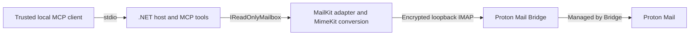

# Approved MVP design

Approved architecture and implementation responsibilities. [PLAN.md](PLAN.md) records authorizations, evidence and pending acceptance; [SECURITY.md](SECURITY.md) defines mandatory controls. Exact tool inputs, results, limits and errors belong in [USAGE.md](docs/USAGE.md); configuration belongs in [CONFIGURATION.md](docs/CONFIGURATION.md).

## Goals and scope

Serve one trusted local MCP client and one Bridge account on Linux over stdio. Discover permitted folders, search summaries and retrieve message text without changing mailbox content or persistent flags. Optional attachment downloads save decoded bytes to private local storage for the client's document tools.

Bridge is separately installed and operated. The server does not manage login, Proton keys or Bridge caches. HTTP, SMTP, body search, multiple accounts, persistent caching/indexing, background synchronization and direct Proton APIs are outside scope.

## Architecture



Keep one `net10.0` console application and one xUnit project:

```text
src/ProtonMailMcp/
  Configuration/   # Validated options, protected files and certificate loading
  Contracts/       # Immutable inputs, results and error categories
  Mail/            # MailKit adapter, MIME conversion, cursors and private downloads
  Tools/           # Three base tools plus configured attachment download
tests/ProtonMailMcp.Tests/
  Unit/
  Protocol/
  Mcp/
  LiveBridge/
  Fixtures/        # Synthetic data only
```

The Generic Host owns DI, validated startup configuration, lifetime and stderr diagnostics. Use the official MCP SDK with explicit stdio transport; do not introduce ASP.NET Core or assembly-wide tool discovery. Dependency pins and maintenance commands are in [DEVELOPMENT.md](docs/DEVELOPMENT.md).

## Application boundary

`IReadOnlyMailbox` exposes four asynchronous, cancellable methods: `ListFoldersAsync`, `SearchAsync`, `GetMessageAsync` and `DownloadAttachmentAsync`. Only immutable application DTOs cross this boundary; MailKit clients, folders and mutable messages stay inside the adapter. MIME conversion is independently testable.

Register the mailbox adapter as a lazy singleton: initialization/discovery validate local settings but make no mailbox connection. Explicitly register three base `McpServerTool` instances; register `download_attachment` only when private storage is configured. The application boundary also rejects downloads when disabled. Base tools are read-only/non-destructive; downloads declare their local write and retained-file side effect. Annotations do not enforce safety.

The MCP boundary strictly deserializes arguments and rejects unknown fields, numeric strings, malformed dates and missing required values before I/O. It produces structured results and equivalent JSON text. Catch runtime failures before SDK formatting; expose fixed codes without underlying exceptions or server text. [USAGE.md](docs/USAGE.md#tool-inputs-and-results) defines the wire contract and cancellation behavior.

## Adapter responsibilities

| Operation | Implementation responsibility |
| --- | --- |
| Folder listing | Resolve configured allowlist names, or enumerate all personal/shared/other namespaces with typed APIs for AllExcept, including unsubscribed folders. Re-enumerate each call; filter denied, duplicate, missing and nonselectable entries. Enforce output bounds without partial success. |
| Search | Build typed AND queries; recipient covers To/Cc. Use sender Date header queries SENTSINCE/SENTBEFORE without internal-date fallback. Retrieve only selected UID summaries in descending UID order. The [pagination contract](docs/SEARCH-PAGINATION.md) defines cursor authentication, range/progress algorithms and race semantics. |
| Message retrieval | Check folder policy and UIDVALIDITY before fetching. Request UID summary/BODYSTRUCTURE first, then only the primary non-attachment plain-text body or HTML converted to text. Preserve alternative/related selection; exclude attached text, containers and messages. Do not concatenate alternatives, fetch full messages/attachments or choose another part to evade a limit. |
| Attachment download | Resolve eligibility against fresh BODYSTRUCTURE; fetch one selected part, strictly transfer-decode bytes into bounded private storage and publish only after safe logout. The [download contract](docs/ATTACHMENT-DOWNLOADS.md) defines identity, limits, retention and commit/failure behavior. |

A top-level body uses `BODY.PEEK[TEXT]`; nested bodies use their numeric section. Reject oversized literals before allocation and oversized writes during transfer. Strict MIME transfer/charset decoding yields an explicit malformed status rather than repaired content. MimeKit converts HTML without rendering, execution or network access. Oversized, missing and unsupported bodies return metadata with an explicit content status.

Sanitize/control-strip metadata and enforce the [output limits](docs/USAGE.md#mailbox-functionality-and-limits); body text preserves line breaks and tabs. Missing optional metadata stays absent. These caps do not bound MailKit's internal metadata parsing or the full matching-UID set.

## Connection lifecycle and failure handling

Serialize operations through an asynchronous gate. Each operation creates one client, connects to the configured literal loopback endpoint, verifies required TLS and the exact certificate pin before authentication, performs its read and logs out/disposes. Never share an active client across calls.

The 30-second deadline includes queue time, I/O and cleanup. Propagate linked client cancellation/deadline tokens throughout. Open folders only read-only and verify access; fetch content through PEEK. No read/write fallback, folder-close command, expunge or automatic retry is permitted. Dispose failed/cancelled sessions immediately; the next call uses a fresh connection.

A post-logout token check enforces the deadline when MailKit absorbs cancellation during logout. Downloads perform this check before atomic publication; afterward their commit semantics apply. Received MCP cancellation notifications reach the adapter; stdin EOF can drain an active operation to its deadline.

Startup configuration errors fail safely; temporary Bridge outages do not prevent MCP initialization. Runtime failures use MCP tool-error semantics, distinct from successful empty searches or metadata-only body statuses. Malformed protocol replies/disconnections map to Bridge-unavailable; rejected commands and unconfirmed read-only access map to protocol failure. See USAGE for exact codes.

## Configuration and observability

Load one explicit external JSON file and protected password/public-certificate files at startup; changes require restart. Enforce the [configuration contract](docs/CONFIGURATION.md) and [security controls](SECURITY.md) rather than adding alternate settings sources.

An explicit folder policy applies before connection and to resolved names. AllExcept permits future folders automatically; exclusions restrict access paths, so overlapping messages can remain visible through other labels. Live acceptance stays limited to one dedicated allowlisted folder.

Stdout contains only MCP traffic. Stderr diagnostics contain only operation, correlation ID, duration and fixed outcome; no content, credentials, identifiers, paths, filters, cursors or raw exceptions. No telemetry or persistent mailbox cache is introduced.

## Decisions and trade-offs

| Decision | Benefit | Cost or limitation |
| --- | --- | --- |
| Stdio, one local user | Small deployment/trust model | No remote/shared service; client decides model disclosure |
| Narrow allowlist or explicit AllExcept | Controlled access or convenient label discovery | AllExcept exposes future folders; exclusions do not hide overlapping messages |
| Serialized, per-operation connections | Simple ownership, cleanup and recovery | Repeated TLS/authentication and no parallel mailbox throughput |
| No persistent cache; forward UID cursors | Less retained plaintext/state | Searches can materialize many UIDs; cursors expire on restart; no snapshot |
| Text/metadata plus optional file handoff | Small default retrieval surface | No server document interpretation; downloads retain plaintext |
| Exact certificate pin | Trust the intended local Bridge | Operator must replace rotated pins |
| Protocol and separate live tests | Verify commands and Bridge behavior | Synthetic success does not establish Bridge compatibility |

Folder enumeration/metadata parsing are not constant-memory for arbitrarily large mailboxes. UIDVALIDITY protects identity, not a snapshot; other clients can change results. Labels can expose the same underlying message in multiple folders; no cross-folder deduplication is planned.

## Primary references

- [Official MCP C# SDK](https://github.com/modelcontextprotocol/csharp-sdk).
- [MailKit folder access](https://mimekit.net/docs/html/T_MailKit_FolderAccess.htm) and [pinned fetch implementation](https://raw.githubusercontent.com/jstedfast/MailKit/4.18.1/MailKit/Net/Imap/ImapFolderFetch.cs).
- [Proton Bridge settings](https://proton.me/support/comprehensive-guide-to-bridge-settings).

References establish feasibility; verify APIs and wire behavior against the pinned release.
